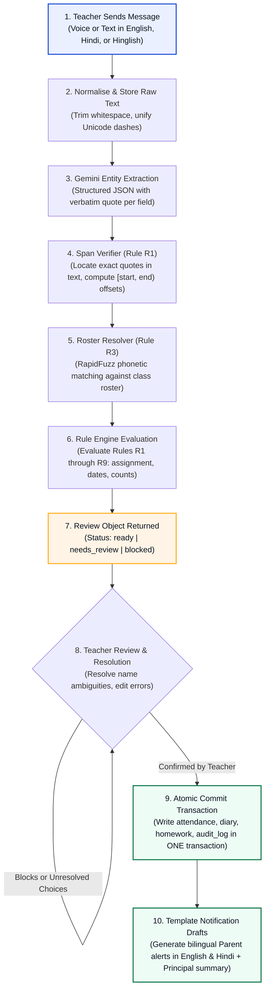
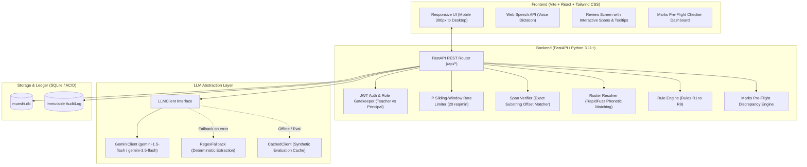

# Munshi (मुंशी)

> **AI proposes. Rules verify. The teacher confirms. The model never writes to the database.**

Munshi turns a teacher's daily classroom voice or text update into verified attendance, class diary entries, homework tasks, and parent alert drafts in seconds.

---

## The Problem

Indian school teachers spend 30 to 45 minutes every afternoon copying attendance records across physical registers, filling out handwritten lesson diaries, and drafting repetitive parent alerts on WhatsApp. Existing School Management Software (SMS/ERP) requires tedious row-by-row form entries that teachers resist on mobile phones. When schools experiment with unconstrained LLMs or voice bots, the models frequently hallucinate names, invent absent students, and silently corrupt permanent school records.

---

## Live Deployment

- **Live Application**: [https://munshi.onrender.com](https://munshi.onrender.com) *(Hosted on Render Free Tier; allows up to 60s for cold-start wakeup)*
- **API Health Endpoint**: [https://munshi.onrender.com/api/health](https://munshi.onrender.com/api/health)

---

## How It Works: The 10-Step Pipeline

Munshi strictly enforces that **the language model never writes to the database**. Steps 1 through 7 only construct a transient review object; records are written solely when the teacher confirms the transaction.



---

## System Architecture



---

## Features by Module

### Module A: Marks Pre-Flight Discrepancy Checker
- **Batch CSV Analysis**: Scans term exam marksheets (700+ rows) for administrative and recording discrepancies before official submission.
- **Rule R8 Verification**:
  - Bound validation: Flags scores exceeding subject maximums (e.g., Theory > 70 or Internal > 20).
  - Negative values & non-numeric text (e.g., `"Absent"`, `"twenty"`, `-5.0`).
  - Arithmetic formula verification: Detects mismatches where `theory + internal != total`.
  - Duplicate detection: Flags duplicate student-subject rows.
  - Missing scores: Identifies blank cells or missing component values.
  - Statistical outlier review: Highlights scores deviating by >3 IQR for teacher double-check.
- **Actionable Evidence Cards**: Each flagged record displays observed value, expected value, broken rule name, evidence description, and a local "Mark as checked" toggle.

### Module B: Daily Classroom Updates
- **Trilingual Speech & Text**: Supports input in English, Hindi (Devanagari script), and Hinglish (colloquial Romanised Hindi).
- **Verbatim Grounding (R1)**: Every extracted entity must carry a verbatim quote directly located in the teacher's original message via `str.find()`.
- **Roster Assignment (R2)**: Blocks submission if a teacher submits attendance for a class they are not assigned to teach.
- **Ambiguity Gatekeeper (R3)**: When a first name matches multiple students (e.g., three Kabirs in Class 8A), the system **strictly refuses to guess silently**, disables the Confirm button, and requires the teacher to choose the correct student by roll number.
- **Count Validation (R4)**: Warns when stated absent count contradicts the number of named absent students.
- **Duplicate Protection (R5 & R9)**: Warns if a student or class has already been marked absent for that day.
- **Calendar Verification (R6)**: Blocks attendance submissions on Sundays, gazetted holidays, or future dates.
- **Syllabus Verification (R7)**: Validates reported lesson topics against the curriculum syllabus.
- **Single Atomic Transaction**: Attendance, class diary, homework, and audit entries commit simultaneously inside one database savepoint.
- **Bilingual Notification Drafts**: Generates parent alerts in English and Hindi alongside principal daily summaries.
- **Principal Audit Trail**: Immutable transaction ledger recording timestamped before-and-after provenance for every confirmed message.

---

## Tech Stack & Design Decisions

| Technology | Role | Reason for Choice |
|---|---|---|
| **FastAPI (Python 3.11+)** | Backend API | High-throughput asynchronous performance, automatic OpenAPI documentation, and strict type validation with Pydantic v2 schemas. |
| **React 18 & Vite** | Frontend SPA | Sub-second dev server HMR, lightweight static production bundles, and modular component architecture. |
| **Tailwind CSS** | Styling | Precise custom design system matching Indian school guidelines (Ink `#0B1220`, Blue `#1F4FD8`, Amber `#FFB020`, Tint `#EAF0FF`). Mobile-first responsive layout tested down to 390px. |
| **Google Gemini API** | LLM Extraction | State-of-the-art multilingual understanding across Hindi, English, and code-mixed Hinglish at zero temperature with structured JSON schema outputs. |
| **RapidFuzz** | Roster Matching | High-speed C++ implementation of Levenshtein and token-sort string matching for phonetic Hindi transliterations and typo tolerance. |
| **SQLite & SQLAlchemy** | Relational Database | Zero-dependency, file-based embeddable database with ACID transaction savepoints and near-instant (<0.1s) boot seeding. |
| **Playwright** | E2E Testing | Browser automation executing end-to-end tests against real running frontend and backend servers in system Google Chrome. |

---

## Run Locally in 5 Commands

### Prerequisites
- Python 3.11+
- Node.js 18+ and npm
- Google Chrome browser installed

```bash
# 1. Clone repository and navigate inside
git clone https://github.com/amansaini/munshi.git && cd munshi

# 2. Setup backend virtual environment and dependencies
cd backend && python -m venv .venv && .venv\Scripts\activate && pip install -r requirements.txt && cd ..

# 3. Setup frontend dependencies and build static assets
cd frontend && npm install && npm run build && cd ..

# 4. Copy built frontend dist into backend static folder
Copy-Item -Recurse -Force frontend/dist backend/static

# 5. Launch unified server (FastAPI serves both API and built frontend)
cd backend && python -m uvicorn app.main:app --host 127.0.0.1 --port 8000
```
Open **[http://127.0.0.1:8000](http://127.0.0.1:8000)** in your browser.

---

## Environment Variables

Copy `.env.example` to `.env`:

```bash
cp .env.example .env
```

| Variable | Description | Default | Required in Live Production? |
|---|---|---|---|
| `GEMINI_API_KEY` | Google Gemini API key | `""` | Yes (for live Gemini extraction) |
| `GEMINI_MODEL` | Gemini model variant | `gemini-1.5-flash` | No |
| `JWT_SECRET` | Secret key for signing JWT tokens | `supersecretjwtkey...` | Yes (generate random string) |
| `LLM_MODE` | Extraction engine mode (`gemini`, `fallback`, `cached`) | `gemini` | No |

---

## Running Tests & Evaluation

### 1. Run Automated Smoke Tests
Tests health check, SPA serving, authentication, message processing, and marks demo in under 2 seconds:
```bash
python scripts/smoke.py http://127.0.0.1:8000
```

### 2. Run Playwright End-to-End Tests
Executes the full 13-test browser test suite against real live servers in Google Chrome:
```bash
# In terminal 1: Start backend
cd backend && python -m uvicorn app.main:app --port 8000

# In terminal 2: Start frontend dev server
cd frontend && npm run dev

# In terminal 3: Run Playwright suite
cd frontend && npx playwright test tests/e2e_live.spec.js --config=playwright.live.config.js
```

### 3. Run the Evaluation Benchmark Harness
Evaluates the 60-message benchmark dataset (`eval/messages.jsonl`) and the 703-row marks dataset:
```bash
# Test message extraction, grounding, and safety rules (offline cached mode)
python eval/run_messages.py --offline

# Test marks pre-flight checker recall against ground truth
python eval/score_marks.py
```

Benchmark output is recorded in `eval/results.json` and documented in `docs/RESULTS.md`.

---

## Team

**Dynaminds**
- **Aman Saini**
- **Anushika**

---

## Synthetic Data Statement

All data in this repository—including student names (`MUN0001` to `MUN0140`), roll numbers, marks, attendance histories, teacher identities, and school timetable schedules—is **100% synthetic**. No real student data, school records, or personally identifiable information (PII) was collected or used.

---

## AI Disclosure

- **Google Gemini API (`gemini-1.5-flash` / `gemini-3.5-flash`)** is used within the runtime application for structured entity extraction from unstructured teacher updates.
- **Google DeepMind Antigravity** and **Anthropic Claude** were utilized as developer assistance tools during code authoring and debugging. All architectural designs, deterministic rule logic, span verifier algorithms, test specifications, and evaluation benchmarks were designed, written, and verified by the human engineering team.
